  
  
  

## About me

I'm a software engineer in Bangalore. I work as a Software Development Engineer II at
TrieCoders, where I build RAG pipelines in a distributed microservice architecture and
plan architecture. Before that I was at Fidelity Investments: two internships, then full
time as a Graduate Executive Trainee on cloud infrastructure, CI/CD and backend.

I studied Computer Science and Engineering, specialising in AI and ML, at SRM Institute
of Science and Technology (2021 to 2025, CGPA 9.40).

What I want to do: use AI to take the menial, repetitive parts out of ordinary days. The
places that need these systems most, such as small operators, public hospitals and
people with access needs, often can't afford the hardware most systems assume, so I
treat compute as a design requirement from day one.

## Projects

Each started as a hackathon, club or college project and is now a ground-up rewrite with
tests and CI.

| Project | What it does | Where it started |
|---|---|---|
| [**SPARK**](https://github.com/johanjoseph02/spark) | Finds free parking spaces from cameras on affordable hardware: a benchmarked edge CNN, live availability, demand-based pricing and an operator dashboard. | Co-authored paper, presented at ICCCNet-2025, hosted by Manchester Metropolitan University |
| [**Quant Hawk**](https://github.com/johanjoseph02/quanthawk) | Unsupervised fraud detection: K-means customer segments, an Isolation Forest per segment, explained alerts, an analyst queue and drift monitoring. | 1st place, Barclays Hack-O-Hire 2024 |
| [**Deshatan**](https://github.com/johanjoseph02/deshatan-app) | Check before you go: community reports on whether public places work for people with access needs. Flutter and Firestore. | Silver Medal, SRM Research Day 2023 |
| [**Replete**](https://github.com/johanjoseph02/replete-platform) | Gets surplus food to people who need it while it is still safe: fair matching, food-safety deadlines and a coded handover. | Top 10, Mozohack 3.0, 2022 |
| [**Event backend**](https://github.com/johanjoseph02/event-backend) | Event registration with waitlists, RSVP reminders and QR check-in that works offline. Express, TypeScript, PostgreSQL. | Alexa Developers SRM, where I built the first version |
| [**Asgn**](https://github.com/johanjoseph02/asgn) | Shows coursework piling up across courses, advises on due dates and rebalances a term. | IEEE Student Branch, SRMIST, research and development |

## What I work with

  <picture>
    <source media="(prefers-color-scheme: light)" srcset="https://skillicons.dev/icons?i=py,java,c,cpp,js,ts,pytorch,react,nextjs,angular,flutter&theme=light">
    
  </picture>
   
  <picture>
    <source media="(prefers-color-scheme: light)" srcset="https://skillicons.dev/icons?i=nodejs,express,spring,graphql,postgres,mysql,mongodb,firebase,supabase,aws,azure&theme=light">
    
  </picture>

Also Hugging Face, LangChain, LangGraph and the Anthropic API for AI work, and CI/CD,
DevOps and MLOps in practice.

## On GitHub

  <picture>
    <source media="(prefers-color-scheme: light)" srcset="https://raw.githubusercontent.com/johanjoseph02/johanjoseph02/output/stats-light.svg">
    
  </picture>
  <picture>
    <source media="(prefers-color-scheme: light)" srcset="https://raw.githubusercontent.com/johanjoseph02/johanjoseph02/output/langs-light.svg">
    
  </picture>

<picture>
  <source media="(prefers-color-scheme: light)" srcset="https://raw.githubusercontent.com/johanjoseph02/johanjoseph02/output/snake-light.svg">
  
</picture>
