  <picture><source media="(prefers-color-scheme: light)" srcset="assets/banner-light.svg"></picture>

  <a href="https://johanjoseph02.github.io/"><picture><source media="(prefers-color-scheme: light)" srcset="assets/portfolio-light.svg"></picture></a>&nbsp;&nbsp;
  <a href="https://www.linkedin.com/in/johan-mathew-joseph-8750a8217/"><picture><source media="(prefers-color-scheme: light)" srcset="assets/linkedin-light.svg"></picture></a>&nbsp;&nbsp;
  <a href="mailto:johanmathewjoseph@gmail.com"><picture><source media="(prefers-color-scheme: light)" srcset="assets/email-light.svg"></picture></a>

 

  <picture><source media="(prefers-color-scheme: light)" srcset="https://raw.githubusercontent.com/johanjoseph02/johanjoseph02/output/languages-light.svg"></picture><picture><source media="(prefers-color-scheme: light)" srcset="assets/toolbox-light.svg"></picture>

  <picture><source media="(prefers-color-scheme: light)" srcset="https://raw.githubusercontent.com/johanjoseph02/johanjoseph02/output/contrib-snake-light.svg"></picture>

